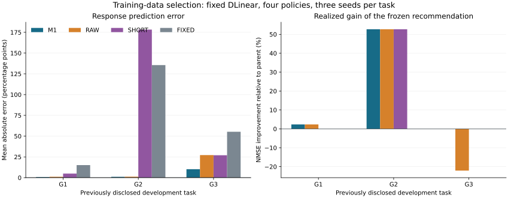

# M1训练数据选择开发：恢复完成与独立补审计

2026-10-14。本轮固定M1、DLinear和事前四动作，36项完整子训练全部完成。原预测锁未修改，完整性、精度、决策增量及预算门槛全部通过。累计完整训练367次。三个任务均来自已揭示Hydraulic开发源；本结果支持进入独立来源确认设计，尚不支持跨源泛化或LLM反馈因果优势。

## 本轮结果

每个任务动作取三种子相对父NMSE改善的算术均值，12格等权计算MAE。正数为改善；误差单位为百分点。

|方法|响应MAE|三个任务平均推荐改善|平均选择遗憾|
|---|---:|---:|---:|
|M1成对校正代理|3.995584|18.336131%|0|
|RAW未校正代理|9.812603|10.974987%|7.361145|
|SHORT预算匹配真实短训|70.061831|17.558429%|0.777702|
|FIXED保留父模型|68.643605|0%|18.336131|

M1较最佳动态精度基线RAW的MAE降低59.2811%，三个任务分别为0.778470、1.028085、10.180196个百分点，均低于RAW。M1比最强决策基线SHORT多0.777702个百分点；最差任务推荐收益0%，满足事前伤害限制。

|任务|M1推荐|真实改善|RAW推荐/改善|SHORT推荐/改善|
|---|---|---:|---|---|
|G1|FAVOR_FIRST|2.333107%|FAVOR_FIRST / 2.333107%|PARENT / 0%|
|G2|KEEP_SECOND|52.675287%|KEEP_SECOND / 52.675287%|KEEP_SECOND / 52.675287%|
|G3|PARENT|0%|FAVOR_FIRST / −22.083434%|PARENT / 0%|

M1在G1补回SHORT遗漏的有效动作，在G3纠正RAW对软偏好的错误正号。G2的大收益三种动态方法均选中，不能全部归因于M1创新。M1覆盖全部3个有效任务动作且未误收伤害；G1/FAVOR_SECOND与G3/FAVOR_SECOND标记跨种子不稳定，均非M1采用项。SHORT在G2/KEEP_FIRST严重高估伤害，拉高总体MAE，因此逐任务误差和选择收益必须与总MAE并列解读。

全部12格及36个种子的预测、真实值、分类、误差能量和检查点诊断见[final_audit.json](final_audit.json)；[全部动作图](figures/all_candidate_responses.svg)保留负结果，各任务使用独立线性纵轴。所有预测均在完整子标签前冻结于原提交`36e82979a8c9768574ac05c515ab218622395239`，原协议及评分定义见[PROTOCOL](../20261013_proxy_selection_r1/PROTOCOL.md)。

## 方法增量与研究整体

此前M1输入变换开发虽降低预测误差，但推荐与FIXED相同，原选择增量失败保持。本轮将问题明确为训练窗口保留/删除/3:1重采样，推理输入不变；FIXED恒零只作保留参照，M1同时通过相对RAW和SHORT的精度与推荐增量门槛。该变化得到新的开发证据，未追改旧阶段结果。

本轮仍只评价固定、有限动作池内的响应代理。没有学习新阈值，没有LLM在线诊断/反馈比较，没有新独立来源或最终测试。M1基于线性预测骨干的精确矩目标和有限Adam轨迹；成对校正本身不构成新的通用无偏估计理论。强影响近似基线的适配仍须按原文与优化器语义验收，见[基线审查](../20261013_proxy_selection_r1/BASELINE_REVIEW.md)。

## 成本、恢复与失败分母

本轮新增36个完整逻辑训练、36个代理轨迹、36个短训。恢复时复用原11个已完成训练，1个从已保存500步恢复后完成，其余24个首次启动；11个复用项未重复计数。累计为331+36=367。独立500→1000步诊断逐位验证模型、Adam及NumPy/Torch/CUDA随机状态，耗时6.394554秒，单列诊断且不计完整训练。

原监督进程中断原因未确认。原完整训练、部分状态与文件全部保持；恢复仅写新聚合目录。首次完整审计因服务器根盘满而写入失败，原日志及部分残差保留。独立审计重试在私有内存目录执行原审计器，新增训练步0；648状态、1188残差数组、36组矩通过，原目录与首次失败目录哈希保持。科学验收通过不删除原中断或首次审计失败记录。[恢复审计](recovery_audit.json)绑定原最终审计和归档收据。

|成本口径|秒|说明|
|---|---:|---|
|完整标签已知运行部分|1292.019087|35个完整计时加中断项已知续训时间|
|完整标签全部耗时|null|中断前与未保存区间耗时未知，不能按零计|
|36个新代理运行|289.459127|不等于含父轨迹与评分的M1总选择成本|
|36个新短训全部运行|516.646647|每项均满足15秒上限|
|恢复阶段实测墙钟|895.959491|与已知运行部分重叠，不再相加|
|审计存储恢复阶段|75.732175|内含原数值审计41.769651秒|

九组任务种子的冷启动账本含真实父、准备和各方法成本：M1 697.973120秒、RAW 625.925025秒、SHORT 839.252300秒、FIXED 325.034389秒。逐组M1及SHORT的选择成本均≤60秒；该上限不适用于另含共同真实父的冷启动总成本。复用父资产的历史耗时计入冷启动账本，未冒充本轮新执行；上述冷启动账本与实际执行成本不可直接相加。额外工程、网络、首次失败审计和内部Sol high用量未完整计量，保留未知。本轮外部模型API新增0，历史2544次/14389704已知tokens及40条未知用量、347757预约tokens不重置。

## 下一步及论文证据缺口

按原门槛进入单一M1独立来源确认设计：锁定新数据身份、训练内A/B/C划分、任务和四动作、成本匹配与强基线、种子及失败判据，再先提交预测后揭示完整响应。已有Hydraulic、MetroPT3、SKAB以及已揭示D均不能重称新来源；基础测试继续隔离。新源选择依据公开任务适用性，不能据候选收益挑源。

论文仍缺独立跨源确认、强近邻基线、选择增量的稳定性、反馈学习的因果比较及冻结后的最终评估。本轮单一开发源三任务不替代这些证据。下一阶段存储预检已触发账户配额错误：根盘满、数据盘仅余608MB、用户持久盘即使显示共享余量也无法写入。详见[存储阻塞及接续步骤](STORAGE_BLOCK.md)，需用户扩容或明确可清理目录；旧实验资产保持，未启动新源实验。

完整归档624852101字节，SHA256 `9751aeb513a3c0a5f50ceae2a9c2f6a5e1765b11d7440d363a210b77f3d51e50`。下载核验见[download_verification.json](download_verification.json)，发布状态以本阶段sync_receipt与release_receipt为准。
