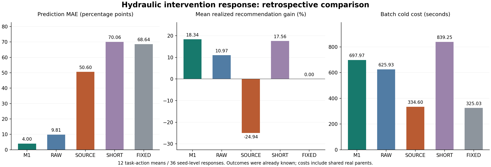

# SOURCE公式适配与M1的Hydraulic回顾性比较

2026-10-14。完整36项SOURCE预测与独立审计通过。本轮在已揭示的G1/G2/G3全部四动作、三个原种子上补齐固定SOURCE公式适配：M1的12格平均响应误差为3.995584个百分点，SOURCE为50.595983；M1三任务推荐的真实平均改善为18.336131%，SOURCE为-24.935907%。SOURCE速度显著更快，但两项推荐造成实际伤害。

这是已知结果上的事后基线补充，不能作为独立确认、跨数据泛化、严格等预算比较或作者Adam实现复现。M1在原MetroPT3/SKAB批次的停止边界不变，不据本轮结果恢复失败候选或调整SOURCE分段、P、阻尼、阈值。

## 同池结果

改善为正表示降低NMSE；预测误差单位为百分点。MAE先对每个任务动作的三种子预测/真值取均值，再比较全部12格。逐种子误差单独列于下表，不能与此主MAE混用。类别采用原±0.25%不变带；任务推荐只看三种子平均预测，最大值至少1%才执行。

| 方法 | 12格MAE | 类别命中 | 推荐真实平均改善 | 伤害推荐 | 整批冷启动秒 |
| --- | --- | --- | --- | --- | --- |
| M1 | 3.995584 | 12/12 | 18.336131% | 0/3 | 697.973120 |
| RAW | 9.812603 | 10/12 | 10.974987% | 1/3 | 625.925025 |
| SOURCE | 50.595983 | 9/12 | -24.935907% | 2/3 | 334.596060 |
| SHORT | 70.061831 | 11/12 | 17.558429% | 0/3 | 839.252300 |
| FIXED | 68.643605 | 0/12 | 0.000000% | 0/3 | 325.034389 |

M1相对本SOURCE适配的MAE低92.1030%，三个任务均不劣；推荐平均收益高43.272038个百分点，最差任务为0%。原20%/0.05个百分点误差尺度、2/3任务不劣和0.10个百分点推荐收益尺度均达到，但只作为事后描述，不补写新验证成功。

| 任务 | M1 MAE | RAW MAE | SOURCE MAE | SHORT MAE | FIXED MAE |
| --- | --- | --- | --- | --- | --- |
| G1 | 0.778470 | 1.071715 | 13.499366 | 4.934163 | 15.114631 |
| G2 | 1.028085 | 1.173656 | 83.068991 | 178.256694 | 135.547980 |
| G3 | 10.180196 | 27.192436 | 55.219594 | 26.994637 | 55.268203 |

| 种子 | M1逐项MAE | RAW逐项MAE | SOURCE逐项MAE | SHORT逐项MAE | FIXED逐项MAE |
| --- | --- | --- | --- | --- | --- |
| 2026101701 | 8.947285 | 8.790379 | 44.334874 | 71.745734 | 63.057716 |
| 2026101702 | 6.945020 | 13.433557 | 52.804882 | 72.287487 | 71.462360 |
| 2026101703 | 10.640509 | 11.818915 | 59.860374 | 76.161809 | 74.689087 |

## 全部动作与决策

| 任务 | 动作 | 真实改善% | M1预测% | RAW预测% | SOURCE预测% | SHORT预测% | FIXED预测% |
| --- | --- | --- | --- | --- | --- | --- | --- |
| G1 | KEEP_FIRST | -44.718922 | -45.545231 | -44.222521 | 3.725856 | -54.668189 | 0.000000 |
| G1 | KEEP_SECOND | -11.786725 | -10.727612 | -13.774183 | -8.001568 | -13.396416 | 0.000000 |
| G1 | FAVOR_FIRST | 2.333107 | 2.938914 | 2.179075 | 2.417225 | -5.424593 | 0.000000 |
| G1 | FAVOR_SECOND | -1.619770 | -2.242421 | -3.268742 | -3.303179 | -2.039764 | 0.000000 |
| G2 | KEEP_FIRST | -420.364924 | -421.703684 | -421.882652 | -97.628379 | -1126.231853 | 0.000000 |
| G2 | KEEP_SECOND | 52.675287 | 52.922167 | 53.719547 | 46.895177 | 54.650855 | 0.000000 |
| G2 | FAVOR_FIRST | -40.875013 | -41.606990 | -41.864889 | -42.566488 | -38.664620 | 0.000000 |
| G2 | FAVOR_SECOND | 28.276696 | 30.071417 | 29.419457 | 30.344529 | 31.250581 | 0.000000 |
| G3 | KEEP_FIRST | -82.764085 | -66.492137 | -49.884021 | 9.174211 | -56.362751 | 0.000000 |
| G3 | KEEP_SECOND | -100.560950 | -112.192953 | -80.711178 | -10.798040 | -42.149894 | 0.000000 |
| G3 | FAVOR_FIRST | -22.083434 | -10.244212 | 11.292083 | 6.628471 | -5.409340 | 0.000000 |
| G3 | FAVOR_SECOND | -15.664342 | -14.686729 | 7.000048 | -5.199078 | -9.172279 | 0.000000 |

| 任务 | 方法 | 推荐 | 真实改善% | oracle遗憾百分点 |
| --- | --- | --- | --- | --- |
| G1 | M1 | FAVOR_FIRST | 2.333107 | 0.000000 |
| G1 | RAW | FAVOR_FIRST | 2.333107 | 0.000000 |
| G1 | FIXED | PARENT | 0.000000 | 2.333107 |
| G1 | SHORT | PARENT | 0.000000 | 2.333107 |
| G1 | SOURCE | KEEP_FIRST | -44.718922 | 47.052028 |
| G2 | M1 | KEEP_SECOND | 52.675287 | 0.000000 |
| G2 | RAW | KEEP_SECOND | 52.675287 | 0.000000 |
| G2 | FIXED | PARENT | 0.000000 | 52.675287 |
| G2 | SHORT | KEEP_SECOND | 52.675287 | 0.000000 |
| G2 | SOURCE | KEEP_SECOND | 52.675287 | 0.000000 |
| G3 | M1 | PARENT | 0.000000 | 0.000000 |
| G3 | RAW | FAVOR_FIRST | -22.083434 | 22.083434 |
| G3 | FIXED | PARENT | 0.000000 | 0.000000 |
| G3 | SHORT | PARENT | 0.000000 | 0.000000 |
| G3 | SOURCE | KEEP_FIRST | -82.764085 | 82.764085 |

SOURCE在G1将KEEP_FIRST预测为+3.725856%，实际−44.718922%；在G3将同动作预测为+9.174211%，实际−82.764085%。这两项是实际方向错误，不能以较低成本抵消。G2选中KEEP_SECOND，与M1相同，实际改善52.675287%。本轮仅能确认该固定适配在这些有限幅度操作上不足；不能仅凭这些标量区分分段/P假设、有限干预线性化及随机Adam路径误差的贡献。

## 计算与审计边界

SOURCE配置和两份公式模块保持工程阶段哈希：500步段、段末父θ/v、固定偏差校正Adam对角P、父完整二次曲率、标准归一化概率梯度差、机器精度负特征值截断。每段对δ做线性传播，参数读出为父θ+δ后转float32，再用原DLinear完整前向。没有optimizer.step、新完整训练或学习新超参数；这不是作者Adam实现复现。

独立审计通过13,824个非零响应块，增广矩阵指数重算的最大δ绝对误差9.6370134095e-13，最大误差/登记容限比9.51023373007e-06。容限按块为1e−7+1e−8×参考最大绝对值。432份候选B/C误差摘要逐字节一致，另核对108份父B/C前向摘要及B选点；15份父/动作A矩独立重建最大误差为0.0。87个预测输入、旧审计真值、代码与全部新资产前后哈希一致。旧四方法的12格和主统计重新计算与原审计一致。

只使用已登记A/B/C和父状态，不访问D或基础validation/test，不新增传感器记录。完整训练累计373不变。公式数值正确不等于预测有效，SOURCE的负结果完整保留。

## 成本

SOURCE九个任务种子方法成本合计11.990924秒，每组1.307086–1.422486秒，包括重新从A构建父+4动作矩（三种子共享并等分）、父状态读取、全部四动作传播/前向/保存/哈希。整批冷启动334.596060秒，另加了历史真实父训练、旧ABC/概率准备及当前载入。九组均低于历史60秒参考，但此处没有重新执行旧方法，不能宣称严格等预算胜出。

预测阶段实测墙钟12.133228秒，已分配执行时间12.038607秒，未分配预检/汇总等开销0.094621秒。独立审计5.301103秒另记；Python启动、网络、最终批次JSON/计时收据写入不在这些计时内，也没有冒充零成本。旧方法沿用原实际冷启动成本及载入时间，因此硬件时段、缓存和实现差异仍在。

## 保存与下一步

科学源代码冻结提交：`93cc9c129ccbb4d1227b618ed95fab11e783a373`；完整预测冻结提交：`e84832bd8d982b080f984c521ad1c9bab2191a50`。本协议SHA256：`ce1c0d83e7c7b98c5b0233592383b15c3c1f6ffba42effe7ad360a76f1971316`。最终GitHub与Release收据见同目录sync_receipt.json；大型参数/矩资产见archive_receipt.json和release_receipt.json，原历史检查点继续使用旧归档。

本轮补上了一个低成本、与训练动态相关的公式基线，未推翻M1在Hydraulic旧池上的相对结果。主要证据缺口仍是跨源泛化和M1的有效成本/可靠性边界。后续应在原停止边界内先归纳失败原因与可检验假设，另行冻结任何新研究；不据本轮事后优势直接新增标签或扩大方法主张。
