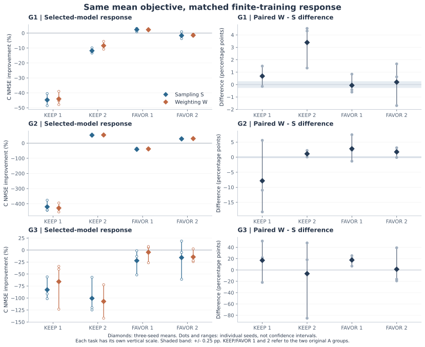

# 同μ采样与加权：真实有限训练响应对照

2026-10-14。36项新加权训练完成、独立审计通过，新增完整训练36，累计409；旧36采样训练与9父只读复用。阶段发布状态以同步收据为准。

## 本轮结果与主张边界

登记池出现跨种子一致的实质响应差异：12格中2格的三个种子配对差全部超过同向0.25pp。该界沿用原基本不变带，属于预登记的实质性/一致性判据，不能称统计显著性或独立泛化。

具体为G1 KEEP_SECOND的W−S均值+3.389844pp、G3 FAVOR_FIRST的+17.552365pp；两格相对父模型仍然有害。全部12格的平均响应类别与1%采用资格均未改变，M1在两实现上仍选中各自最优动作或PARENT，选择遗憾均0。M1对W的MAE还低于S，故本轮支持数值响应的结构性信息缺口，未显示该缺口损害当前池的推荐，不能据此直接扩展复杂方法。

两实现使用相同μ=pw，M1沿用相同冻结预测；真实训练随机梯度完整分布不同。结果不能将因果机制唯一归结为方差迹，不能否定M1在旧S动作池上的已验收成绩，也没有建立新方法。旧S结果在设计前已知，新W的全部36项预测与协议在训练前冻结；三G任务来自同一Hydraulic来源。

## 完整12格主表

S按旧p采样、权重1；W均匀采样全部6468窗口、权重Np。每格为三个共同种子的平均相对父C NMSE改善，B仍按六检查点最早最小值选择。零权重样本保留在256个样本的固定分母内。所有36种子和216固定步对比另附CSV，不按结果删选。

|任务|动作|S改善%|W改善%|W−S pp|配对差类别|同μ预测误差下界 pp|
|---|---|---:|---:|---:|---|---:|
|G1|KEEP_FIRST|-44.718922|-44.037230|+0.681692|no_stable_material_gap|0.340846|
|G1|KEEP_SECOND|-11.786725|-8.396881|+3.389844|W_better|1.694922|
|G1|FAVOR_FIRST|2.333107|2.270105|-0.063001|opposite_beyond_band|0.031501|
|G1|FAVOR_SECOND|-1.619770|-1.421465|+0.198305|opposite_beyond_band|0.099152|
|G2|KEEP_FIRST|-420.364924|-428.220756|-7.855832|opposite_beyond_band|3.927916|
|G2|KEEP_SECOND|52.675287|53.794211|+1.118924|no_stable_material_gap|0.559462|
|G2|FAVOR_FIRST|-40.875013|-38.071763|+2.803249|opposite_beyond_band|1.401625|
|G2|FAVOR_SECOND|28.276696|30.018001|+1.741305|no_stable_material_gap|0.870653|
|G3|KEEP_FIRST|-82.764085|-65.752652|+17.011433|opposite_beyond_band|8.505717|
|G3|KEEP_SECOND|-100.560950|-107.017839|-6.456889|opposite_beyond_band|3.228444|
|G3|FAVOR_FIRST|-22.083434|-4.531069|+17.552365|W_better|8.776183|
|G3|FAVOR_SECOND|-15.664342|-14.391868|+1.272474|opposite_beyond_band|0.636237|

M1的S/W MAE分别为3.995584/2.352405pp，联合24格MAE为3.173994pp，最差格绝对误差16.271948pp。任何对S/W给出同一标量预测的模型，联合误差均值至少为2.506055pp；逐种子口径下界为6.199640pp。下界由|S−W|/2及三角不等式直接得到，不是新理论；它仅针对忽略p/w区别的预测信息限制。

共有0格跨实现响应类别改变，0格跨越1%采用资格，22/36对选择了不同检查点。固定步明细用于区分选择与轨迹差异，不能据C曲线重新选择模型。summary.json包含每任务/步的绝对差统计。

## 相同预测的推荐表现

|任务|同一M1推荐|S真实收益%|W真实收益%|S遗憾pp|W遗憾pp|
|---|---|---:|---:|---:|---:|
|G1|FAVOR_FIRST|2.333107|2.270105|0.000000|0.000000|
|G2|KEEP_SECOND|52.675287|53.794211|0.000000|0.000000|
|G3|PARENT|0.000000|0.000000|0.000000|0.000000|

推荐仍按M1最大预测均值且至少1%采用；oracle取四个实际动作与PARENT的最大真实收益。不同实现分别计算遗憾，本轮没有新增短训/其他方法或严格同预算比较。

## 独立验收与成本

324个新状态（252初始/常规、72见证）、36均匀采样计数/RNG、全部B选择、144份新旧选定B/C残差核对通过。独立在初始和500步各回放一次，72次诊断更新的模型/Adam/随机状态与见证逐位一致；这些不是额外完整模型。原输入603文件前后哈希保持，冻结M1预测绑定原预测不变，D及基础validation/test未访问。

36完整训练计时总和1329.791259秒，独立审计14.980397秒。训练计时包含初始化、B/C评分、见证保存和资产哈希；管理/传输未独立计时，保持未知。旧采样中断前未知成本仍为null，不追填或计入本轮新增训练。

## 整体研究位置与后续

本阶段检验M1对训练实现的可分辨性；旧M1数值失败、补审计、Hydraulic开发成果、SOURCE事后比较以及关闭的M/S批次均保持。Appliances暂停，fs/fs_public禁用。后续必须根据完整结果决定是否需要可区分p/w的诊断表达，并另冻方法与对照，不能直接把当前配对差作可用预测信号或追调旧阈值。

下一步先做单一噪声感知响应代理的必要性及近邻方法审查：明确它能额外预测什么、额外成本以及怎样检验选择增量；若只重现本轮已知数值差异而没有可检验的决策价值，则不启动该方法的扩展训练。当前没有新的方法或模型队列。

论文仍缺具有独立预测/选择价值的方法、跨来源确认、反馈学习的增量证据及冻结后的最终评估。本轮同源结构性检验不能替代这些证据。
