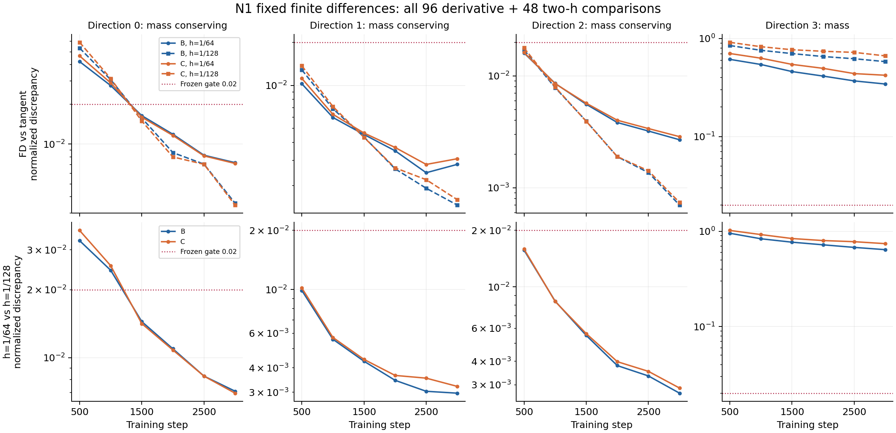

# N1固定有限差分结案：原数值门槛未通过

2026-10-15。16条预登记3000步诊断训练全部成功，完整独立复现通过；原有限差分数值门槛为false。本轮关闭后续提案入口，不调整步长、容差、低信号下界、方向或检查点，也不追加训练追求通过。此前九父光滑映射导数及成本工程通过的结果保留。

## 完成与结果

独立审计逐位复核全部112个模型/Adam/RNG状态、192组B/C残差及抽样计数，16条均通过。实际float32权重由独立构造的W重建，实际正负差分方向包含舍入引入的其他方向分量。五个运行/审计控制阶段均exit0，终态核查未发现本阶段已知监督或子进程继续运行。

| 预登记方向 | 导数比较通过 | 最大归一化误差 | 两h比较通过 | 最大归一化误差 |
|---|---:|---:|---:|---:|
| 0：质量守恒 | 16/24 | 0.058950369 | 8/12 | 0.036581317 |
| 1：质量守恒 | 24/24 | 0.013711442 | 12/12 | 0.010193228 |
| 2：质量守恒 | 24/24 | 0.017841043 | 12/12 | 0.015909815 |
| 3：整体质量诊断 | 0/24 | 0.914564940 | 0/12 | 1.022712955 |
| 全部 | 64/96 | 0.914564940 | 32/48 | 1.022712955 |

原门槛要求全部比较≤0.02。方向0在500和1000步、B/C及两种h的8项导数比较均失败，其4项双h比较也失败；1500步以后通过。第四方向全部失败。因此，即使只描述三个质量守恒方向，仍有未通过项，不能把失败完全归因于第四诊断方向。按事前定义标记为低信号的项为0，不能事后排除这些项。

图包含全部96导数和48双h比较；各面板使用独立对数纵轴，红色虚线是相同的0.02门槛。完整绝对误差、比较向量范数、父残差范数及分母见fd_derivative_table.csv、fd_two_h_table.csv。

这说明本次固定邻域下的光滑路径线性化没有达到事前规定的完整float32程序近似精度。现有证据不能单独区分局部非线性、float32舍入与固定舍入偏移映射之间的贡献；本报告不赋予未经实验识别的因果解释。两个h之间也有不一致，故不能把所有差异直接解释为切线递推公式错误。此前独立NumPy/JVP一致性只支持已声明的光滑映射计算。

## 成本与计数

16条完整诊断训练内部计时合计592.311038660秒，FD阶段外层592.359136721秒；独立16轨迹回放及144比较592.268383140秒。新增完整训练16、累计434，执行失败0；独立回放另列，不重复计为新增科学训练。原数值门槛失败1批与执行失败分开记账。

此前九父路径阶段380.881720628秒、独立路径审计979.275282044秒、真实批次预检5.324648707秒另见PATHS_REPORT.md。传输、人工开发和未独立计时的交付步骤不填零，这些数字不称为整个研究的总耗时。必要路径成本入口通过不等于完整N2成本或科学效果通过。

## 边界、后续与论文缺口

本阶段位于响应代理的工程可信度检验，得到一项可复现负结果。N2科学提案0，旧M1完整标签0；D、基础validation/test及fs/fs_public均未访问。Hydraulic三任务仍为同源已揭示开发任务。

先归档并核对阶段GitHub提交和Release，再只读梳理失败边界与论文主张。当前N1路线的后续提案关闭；不借更名、删方向、挑K、缩h或放宽阈值重新判为通过。旧N2的M1完整标签前置依然未满足，旧关闭批次保持关闭。任何新的研究问题都须独立论证合法性、必要性、创新边界与强对照，并单独冻结，不能用本轮FD结果挑选有利任务或调整N2常量。

距离可投稿方法成果仍缺达到可信精度的响应方案、相对强重权/等成本对照的真实决策增量、多种子稳定性、独立来源确认及必要消融。当前结果不支持新方法优势，也不完成论文目标。

冻结执行器提交f0480b0218e65a830aedce1c80af42af0bd8ac01；fd_plan SHA256为3a6ea18864ce39fc9f63b89ea033f59922256030a298e5cb2bbcfcfda161b156；fd_audit SHA256为a27f9988a488505f98be6189dc9eb02906191289d809a455fb5ab5c4921ebf30。复核顺序见FD_REPRODUCE.md；交付核验以fd_sync_receipt.json为准。
