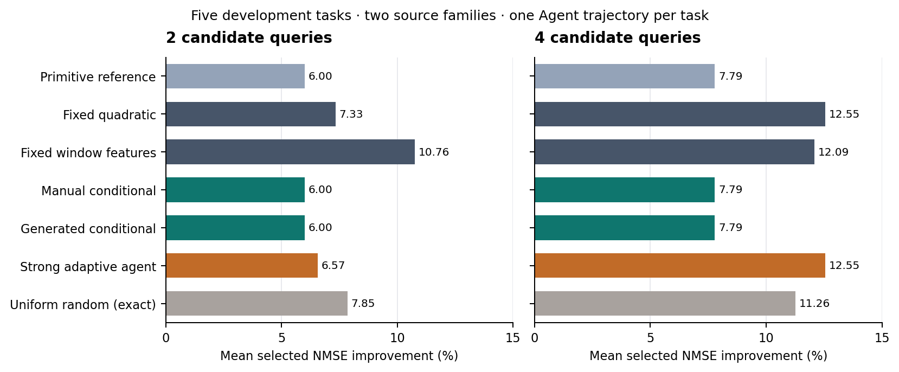

# 强提示词自适应Agent对照：r5结果

## 本轮完成

固定5任务×4顺序查询的20次Sol high调用全部成功，10个2/4查询节点完成独立验收。采用完全相同的32候选池、源家族留出和原1%均值收益／−1% NMAE护栏。每次先保存输入、模型建议和提示词哈希，再查询LLM，合法回复封存后才揭示所选候选的历史真实响应。本轮新增预测骨干完整训练0，累计仍464。

Agent接收26原特征、同源条件生成的两个窗口测量及其定义、源任务完整响应和自身已查询响应。另提供三个使用相同合法记录拟合的回归建议，Agent可自主推翻。它不见未查询目标标签。比较按候选查询数对齐；这项强对照的LLM与拟合成本单列，不宣称端到端等成本。

调用前审查40项通过并发现事件日志解析异常漏记失败收据的问题；主代理修复后另做3项窄补验通过，保留原审计。源码提交`7b2a165602c8aa83cbf2f32b6f19eafec9a743f7`在调用前发布并核验。首次启动被自动审批拒绝，用户随后明确授权这20次调用；拒绝和授权记录均保留，拒绝时实际调用0。

## 真实选择结果

单位为五任务等权平均NMSE改善百分比；更高更好。所有行共享同一采用规则，未合格则保留父。

|策略|2查询|4查询|
|---|---:|---:|
|原始22量参考|6.003600|7.786365|
|固定26量二阶|7.332344|12.554207|
|固定窗口量线性|10.758842|12.087586|
|固定窗口量二阶|5.655339|12.087586|
|人工专家等权|6.003600|12.541607|
|人工专家条件更新|6.003600|7.786365|
|普通生成：等权／联合／条件／合并四种|6.003600|7.786365|
|失配生成：等权／联合／条件／合并四种|6.003600|7.786365|
|强提示词Agent|6.570246|12.554207|
|均匀无放回随机：精确期望|7.854946|11.262031|

随机基准枚举全部308个任务／预算子集，未经随机种子挑选；独立算术核对通过。它不使用源反馈，评价用到的完整标签没有提供给Agent。

|任务|Agent 2查询：采用项／改善|Agent 4查询：采用项／改善|
|---|---|---|
|ETTh1|父／0%|父／0%|
|ETTh2|FAVOR_EARLY/W／2.241425%|FAVOR_EARLY/S／6.643717%|
|G1|FAVOR_FIRST/S／2.333107%|FAVOR_FIRST/S／2.333107%|
|G2|FAVOR_SECOND/S／28.276696%|KEEP_SECOND/W／53.794211%|
|G3|父／0%|父／0%|

四查询Agent达到有限候选池oracle，与固定二阶一致，超过当前条件生成4.767842个百分点。两查询Agent比固定二阶低0.762098个百分点、比随机期望低1.284700个百分点。不能把四查询相等写成Agent超越固定基线，也不能忽略早期预算的劣势。

G2在第三次查询观察KEEP_SECOND/S的约52.7%收益后，第四次选择同暴露的W实现，实际达到53.794211%；这是一条可核对的有用后续选择。它不能单凭文本理由证明机制因果，也没有由同一前缀的反馈分叉验证。ETT每任务只有4候选，四查询已穷尽菜单；该节点的无遗憾不代表高效探索。ETTh2最终均值采用含1个退化seed，不能称稳定胜出。

## 验收与成本

独立结果审计7组全部通过，覆盖20调用信息边界与哈希链、5轨迹、10节点、120个模型组件；786项数值比较最大绝对差4.44e−16。独立模型重算未调用生产fit。原40项门禁和3项异常补验未重复；随机308子集另行核对。审计不证明远端真实模型身份或服务时间因果，模型身份以请求记录为准。

20次调用输入577,291、输出10,160 tokens（其中推理输出8,003）；调用时间合计2,591.495384秒，四轮并发从首请求到最后揭示544.441746秒。准备／三模型拟合及序列化内部计时合计1.272354秒。20条WebSocket转HTTPS传输回退均保留，每次只有一次完成事件，没有追加Agent重复。实际货币账单未知。

冷启动还需计入实际复用的两次r4条件生成：391.431014秒调用时间、114,079输入及6,873输出tokens；这些是历史成本，本轮没有重新调用。父窗口提取与完整模型成本应在总体成本中继续列出，不能视为免费。10个节点中9个历史查询耗时可核实，G1四查询保持null。每任务2/4查询逻辑上分别对应6/12次三seed子训练，共同父3次另计；本轮实际均复用旧结果。

Agent事前点预测在其自适应查询到的20个候选上，Y/Z MAE分别13.225500／4.470110个百分点。该量包含逐步目标反馈且样本由Agent选择，不能直接与r4全候选初始误差比较来宣称预测更准。

## 整体环节、下一步与论文缺口

当前处于回顾性方法开发的强对照验收阶段。r2尺度修正、r3真实父窗口接口、r4可执行新测量及r5强Agent均已完成；技术可执行性与信息隔离已有证据，拟议方法的H1信号增量、H2条件更新增量、H3决策优势仍未成立。Agent也使用条件生成的测量，故不能凭本对照单独断言这些测量对一切决策器都无用。

本轮另给出明确数学边界，见DESIGN_BOUNDARY.md：较高条件Z对数评分不约束专家的Y边缘，因而不能保证用该评分直接加权Y预测会改善选择。这是一般性无保证反例，不是当前失败的唯一因果解释，也不是数学创新。RELATED_WORK.md补齐适当评分、一般损失更新、CAAFE和LLAMBO等直接近邻。

下一步应先论证诊断可靠性如何控制与Y选择有关的参数或适用范围，并给出可被否定的桥接假设。本池不追加提示词、Agent重复、特征或温度来追结果。新来源完整训练与开放方案生成不因完成20调用而自动激活；在当前方法增量未成立时扩大确认数据，不能代替解决机制缺口。

论文仍缺：有区别于近邻且能改善选择的机制、同一隐藏前缀的反馈因果对照、来源级独立确认与足够任务重复、完整端到端成本。本阶段更新研究工作稿和图表；不称可投稿方法已经完成。D/test、旧关闭批次、存储禁区与全局索引仅本地边界保持。

完整产物及失败记录按release_manifest、sync_receipt和metadata_sync_receipt交付；只有远端提交及归档大小/SHA核验后才记同步完成。
