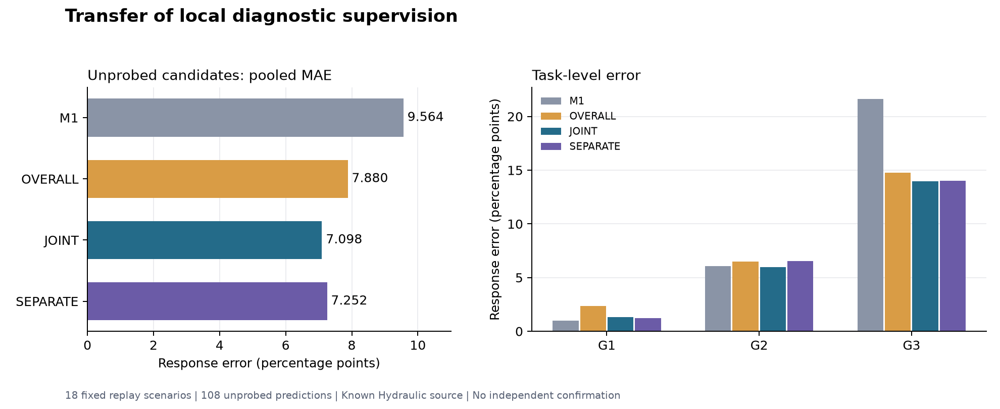

# 跨候选诊断学习：18情境开发结果

2026-10-22。主实验已完整运行并验收。**局部诊断监督具有本轮开发增量：JOINT相对OVERALL的未探测候选响应MAE从7.879503降到7.097952个百分点，下降9.9188%，18个固定情境中17个改善。诊断—方案分离更新尚未带来额外优势：SEPARATE为7.252321个百分点，较JOINT增加0.154369个百分点。** 两个诊断组自身产生的推荐都保持原M1的逐任务真实收益。

本轮为已揭示Hydraulic来源的任务留出开发回放，三个任务并非三个独立数据来源。原H1获得描述性支持，H2不支持，要求两者同时成立的完整开发条件为false。没有把联合更新的正结果算作分离更新的成功。

## 本轮完成内容

固定3任务×3seed×4动作。每次留出一个目标任务，将另外两个任务的24候选作为历史数据；目标任务开放两个动作的500步真实前缀，另两个动作的真实前缀和所有目标完整收益均对学习器隐藏。四选二的6种开放组合全部运行，共18情境、108条未探测预测、216条完整菜单预测/方法。每个原候选在多个情境重复出现，不能将108条当作108个独立实验。

历史任务可提供完整响应Y、前缀总体误差P和通道诊断Z。Z是父偏差应保留比例的有界投影系数；诊断网络用每通道三个便宜特征预测该比例，价值头只作响应的仿射残差校准。所有组三个信息来源和更新路径按[PROTOCOL.md](PROTOCOL.md)冻结：OVERALL使用P/Y，JOINT增加Z监督，SEPARATE在相同P/Y/Z下阻止Y损失更新诊断网络。三组容量、初始化和1000次更新一致。补充固定岭回归、RAW和M1对照，另列获得全部四动作前缀的上一轮逐候选收缩参照。

已完成54次辅助拟合、54,000次辅助更新、18次闭式岭回归。骨干完整训练和LLM调用新增0，历史完整训练累计仍为593。输入准备、预测锁定、独立重算和完整评价均完成。

## 预测精度与选择收益

主指标为未探测候选的响应MAE，单位为百分点。推荐按四动作的三seed平均预测和原1%采用门槛产生；每情境先选动作，再评价真实收益，未用M1推荐替换新方法推荐。

| 方法 | 未探测MAE | 全部候选MAE | 推荐真实平均改善 | 有害推荐情境数 |
|---|---:|---:|---:|---:|
| RAW | 8.074144 | 8.074144 | 17.768573% | 6/18 |
| M1 | 9.564270 | 9.564270 | 18.863060% | 0/18 |
| OVERALL：总体反馈 | 7.879503 | 7.937646 | 17.769990% | 4/18 |
| **JOINT：增加局部诊断** | **7.097952** | **6.949769** | **18.863060%** | **0/18** |
| SEPARATE：分离更新 | 7.252321 | 7.170425 | 18.863060% | 0/18 |
| RIDGE_Y：简单残差回归 | 18.247185 | 18.234746 | 18.863060% | 0/18 |
| 逐候选收缩参照：全部四动作前缀 | 6.730335 | 6.730335 | 18.863060% | 0/18 |

JOINT较M1降低25.7868%，SEPARATE较M1降低24.1728%。逐候选收缩参照拥有未探测动作的真实前缀，因此其6.730335不属于本轮同信息预算比较，不能将本轮解释为超越该参照。岭回归误差较大也说明，保持推荐本身不保证响应预测准确。

| 目标任务 | M1 MAE | OVERALL MAE | JOINT MAE | SEPARATE MAE | 两个诊断组各6情境的推荐 | 推荐真实改善 |
|---|---:|---:|---:|---:|---|---:|
| G1 | 1.000539 | 2.361186 | 1.343658 | 1.225067 | FAVOR_FIRST | 2.180474% |
| G2 | 6.084319 | 6.506016 | 5.967564 | 6.538572 | KEEP_SECOND | 54.408705% |
| G3 | 21.607952 | 14.771305 | 13.982635 | 13.993324 | PARENT | 0% |

H1的三个任务均值同向改善；18情境有17个改善、1个退化。总体反馈组在G1的3个情境退回PARENT，在G3的4个情境误选FAVOR_FIRST；局部诊断组在这7处改变推荐，使平均真实收益增加1.093070个百分点。这是相对OVERALL的本轮开发选择增量，**相对M1的选择增量仍为0**。

H2在G1改善0.118590个百分点，在G2退化0.571008，在G3退化0.010689；18情境各9个改善和退化。不能以G1结果覆盖主指标上的失败，也不能据这组描述性结果声称分离更新一般无效。当前模型把500步诊断系数固定到全部后续检查点，这一表示与完整收益的联系仍需改善；本轮没有识别H2不成立的唯一原因。

所有18情境、各动作三seed均值误差及完整动作排序见[scenario_summary.csv](scenario_summary.csv)和[action_summary.csv](action_summary.csv)；逐候选数据见[candidate_summary.csv](candidate_summary.csv)。未选择有利开放组合，未追加特征、损失权重、前缀长度或种子扫描。

## 验收、运行恢复与成本

三项必要实现检查通过：二次误差曲线端点和真实前缀覆盖、Y梯度隔离、目标完整标签与未开放前缀隔离。独立NumPy程序重算18输入情境、72模型的864项预测，并验证18个岭回归正规方程，全部通过。预测锁SHA256为`8a4ccc5c19e7a01a9e49f1bf6845b28b9d4dd065ceb129078414b83b2bcde583`。

首个服务器准备阶段在第一个候选的低能量通道上未通过与旧CPU结果的一致性检查，原失败保留在control目录。将同一冻结准备程序移回原PyTorch 2.6 CPU环境后，一次构造全部输入包并通过原容差；未改公式或放宽标准。新的恢复监督继续运行原冻结学习器及评价，2026-10-22 11:31:29 UTC全部完成。恢复前没有辅助模型或本轮科学结果，详见[PREPARATION_RECOVERY.md](PREPARATION_RECOVERY.md)。报告绘图首次因研究虚拟环境缺少Matplotlib未运行，改用本机已有文档运行环境生成；未安装依赖或影响模型结果。

本地输入准备进程内约13.245秒。服务器辅助拟合与预测阶段进程内65.910秒，其中OVERALL/JOINT/SEPARATE/岭回归分别合计22.547/22.828/19.071/0.045秒；独立重算0.457秒。恢复监督从拟合到评价结束墙钟72.946秒，包含三个程序启动与导入，但不包含本地准备、传输和首次失败，不能作为全研究端到端时间。

| 目标任务 | 历史两任务完整训练账本 | 历史代理账本 | 目标共同父账本 | 目标四动作代理账本 | 目标两动作前缀均值 | 全四动作前缀参照 |
|---|---:|---:|---:|---:|---:|---:|
| G1 | 1145.130秒 | 179.911秒 | 111.360秒 | 87.366秒 | 37.104秒 | 74.209秒 |
| G2 | 1146.509秒 | 177.185秒 | 110.671秒 | 90.093秒 | 37.053秒 | 74.106秒 |
| G3 | 1147.159秒 | 177.459秒 | 110.993秒 | 89.818秒 | 37.080秒 | 74.160秒 |

该表为原GPU运行记录的复用成本，各情境共享旧资产，不能相加当作本轮新增训练。历史学习成本未记为0。每情境目标前缀由4动作减为2动作，枚举组合平均的前缀账本恰减半；完整目标成本仍包括共同父、全部代理和新增辅助拟合，未测定同设备完整冷启动节省率，也未完成重新匹配预算的短训练比较。混合设备、缓存复用和启动成本的限制均保留。

原始输入、旧运行ID、D/test、北京清理及fs/fs_public边界保持。本阶段全部研究计算已结束，没有待续模型队列。下载归档123成员、2,962,436字节，全部122登记文件哈希核验通过；最终含报告的交付状态以delivery_receipt及同步收据为准。

## 整体研究位置、下一步与论文缺口

本轮已从逐候选直接校准推进到**跨候选诊断学习**：在目标只开放两动作前缀的条件下，增加局部Z监督改善了未探测动作预测，并优于同容量总体反馈组。这是当前研究主线中的H1开发证据，尚未建立H2和完整方法优势。

下一步的核心实现方向是**学习诊断偏差随训练进程的演化**：利用历史完整轨迹建立后续检查点的局部诊断目标，目标任务仍只用固定500步前缀，把本轮JOINT作为固定对照，检验动态诊断是否同时改善预测与分离更新。这里提出一个新的机制方向；其模型、预算和留出协议尚未冻结，不代表本轮已执行。继续使用原有数据，不靠本池损失权重或前缀扫描追赶本轮结果。

距离论文成果仍缺：诊断—方案分离更新的可重复增量、原有其他来源上的确认、同设备与同成本强对照，以及相对于标准监督回归/模块化学习的实质方法贡献。G1精度未超过M1，三个任务属于同一来源，平均MAE的降低也未转化为相对M1的额外选择收益。当前结果支持继续推进诊断学习，不能将这次实现直接称为原创或已可投稿方法。

## 复现与资产

本阶段包含完整18输入包、72辅助模型、冻结科学源码、预测锁、全部结果和失败/恢复日志。使用归档输入包可以直接复现run/audit/evaluate：先将PROTOCOL.md、source_lock.json、source_snapshot、fold_manifest.json、folds、features.json、prefix_feedback.json和evaluation_truth.json复制到新的空结果目录，再依次运行source_snapshot中的run_transfer_diagnosis.py、audit_transfer_diagnosis.py、evaluate_transfer_diagnosis.py，参数均为`--stage 新目录`。程序拒绝覆盖已存在结果。

重建输入需要[原前缀实验归档](https://github.com/CangLing-Cerulean/auto_data/releases/tag/research-20261022-m1-contribution-r1)和[上轮收缩归档](https://github.com/CangLing-Cerulean/auto_data/releases/tag/research-20261022-m1-shrinkage-r1)，分别为84,728,844和13,810,205字节。原始数组/骨干参数不重复放入本阶段归档。按已记录的本地PyTorch 2.6 CPU环境执行prepare_transfer_diagnosis.py，输入参数为`--source 原前缀目录 --shrinkage 上轮收缩目录 --stage 新目录`；学习器在本轮服务器PyTorch 2.14、CPU单线程、float64环境执行。源码和科学设定以原[source_lock.json](source_lock.json)为准，后加的恢复/报告工具单独记录。
